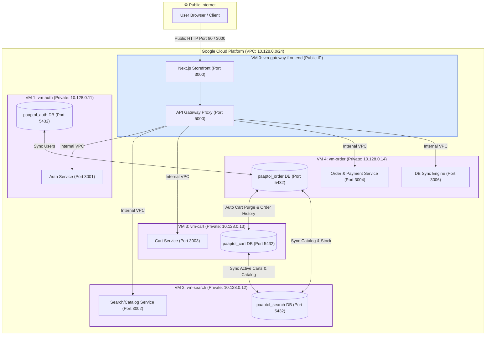

# GCP Microservices Multi-VM Deployment & Database Synchronization Guide

This guide details how to host the **Paaptol E-Commerce** application across **separate Google Cloud Platform (GCP) Compute Engine VMs**, strictly meeting every requirement:

1. **Maximum 4 microservices**, each with its respective mini-database hosted on a separate VM.
2. **Strict network security**: ONLY the Frontend / API Gateway VM has a public External IP. The 4 microservices are completely isolated inside a private VPC.
3. **Database Synchronization**: An automated cross-database sync engine continuously synchronizes user data, inventory, stock events, and orders between the 4 mini-databases across the private VPC network.

---

## 🏛 Architecture Diagram



---

## 📋 Microservices & Mini-Databases Mapping

| VM Name | GCP Network Address | Microservice Running | Mini-Database Hosted | Purpose |
| :--- | :--- | :--- | :--- | :--- |
| **`vm-gateway-frontend`** | **External Public IP** + Internal `10.128.0.10` | Next.js Frontend (Port 3000) & API Gateway (Port 5000) | None | Handles all incoming user traffic, reverse proxies to internal microservices |
| **`vm-auth`** | **NO External IP** (Private `10.128.0.11`) | Auth Microservice (Port 3001) | PostgreSQL `paaptol_auth` | User accounts, credentials hashing, JWT verification |
| **`vm-search`** | **NO External IP** (Private `10.128.0.12`) | Search / Catalog Microservice (Port 3002) | PostgreSQL `paaptol_search` | Product catalog, pricing, category filters, inventory management |
| **`vm-cart`** | **NO External IP** (Private `10.128.0.13`) | Cart Microservice (Port 3003) | PostgreSQL `paaptol_cart` | User cart state, session-persistent cart storage |
| **`vm-order`** | **NO External IP** (Private `10.128.0.14`) | Order & Payment Microservice (Port 3004) + DB Sync Engine (Port 3006) | PostgreSQL `paaptol_order` | Order placement, payment processing simulation, cross-DB sync |

---

## 🚀 How to Deploy on Google Cloud Platform

### Method 1: Using Google Cloud Shell (Fastest & Recommended)

Google Cloud Shell has `gcloud`, `git`, and authentication pre-installed:

1. Open your browser and go to [Google Cloud Shell](https://shell.cloud.google.com).
2. Select your GCP project:
   ```bash
   gcloud config set project <YOUR_PROJECT_ID>
   ```
3. Clone this repository (or upload your files):
   ```bash
   git clone https://github.com/Anosh26/Ecommerce.git
   cd Ecommerce
   ```
4. Make the deployment script executable and run it:
   ```bash
   chmod +x gcp/deploy-gcp.sh gcp/teardown-gcp.sh gcp/startup-scripts/*.sh
   ./gcp/deploy-gcp.sh
   ```
5. The script automatically creates:
   - Custom VPC `ecommerce-vpc` & Subnet `ecommerce-subnet` (`10.128.0.0/24`)
   - Cloud Router & Cloud NAT (so private VMs can download packages/docker)
   - Strict Firewall Rules (blocking all public access to microservices)
   - All 5 Compute Engine VMs with automated startup initialization
6. Once complete, the script prints the **Public External IP**:
   ```
   🌐 Public Ecommerce URL: http://<EXTERNAL_IP>:3000
   🚪 API Gateway URL:     http://<EXTERNAL_IP>:5000
   🔄 DB Sync Health API:  http://<EXTERNAL_IP>:5000/api/sync/status
   ```

---

## 🔍 How to Verify Every Requirement

### 1. Verify "Only Frontend / Gateway has an External IP"
Run the following gcloud command:
```bash
gcloud compute instances list --filter="zone:us-central1-a" --format="table(name,networkInterfaces[0].networkIP,networkInterfaces[0].accessConfigs[0].natIP)"
```
**Expected Output:**
```
NAME                 INTERNAL_IP  EXTERNAL_IP
vm-gateway-frontend  10.128.0.10  34.x.x.x      <-- ONLY ONE WITH EXTERNAL IP
vm-auth              10.128.0.11                <-- BLANK (Private)
vm-search            10.128.0.12                <-- BLANK (Private)
vm-cart              10.128.0.13                <-- BLANK (Private)
vm-order             10.128.0.14                <-- BLANK (Private)
```

### 2. Verify External Isolation (Public Firewall Block)
From your own computer or terminal, try accessing the internal services:
```bash
# This will SUCCEED (Frontend is public):
curl -I http://<EXTERNAL_IP>:3000

# This will TIMEOUT or BE BLOCKED (Microservice databases are not exposed publicly):
curl -m 3 http://<EXTERNAL_IP>:54321
```

### 3. Verify Database Synchronization
Query the DB Sync Engine endpoint through the API Gateway:
```bash
curl http://<EXTERNAL_IP>:5000/api/sync/status
```
**Response JSON:**
```json
{
  "service": "db-sync-engine",
  "status": "healthy",
  "metrics": {
    "lastSyncTime": "2026-10-14T08:30:00.000Z",
    "totalCycles": 42,
    "syncedUsers": 2,
    "syncedProducts": 6,
    "syncedStockEvents": 3,
    "syncedOrders": 1,
    "lastError": null,
    "databases": {
      "auth": true,
      "search": true,
      "cart": true,
      "order": true
    }
  }
}
```

Or trigger a manual synchronization cycle at any time:
```bash
curl -X POST http://<EXTERNAL_IP>:5000/api/sync/trigger
```

---

## 🧹 How to Teardown / Clean Up GCP Resources

To avoid incurring ongoing cloud costs when you are done demonstrating:
```bash
./gcp/teardown-gcp.sh
```
This cleanly removes all 5 VMs, the Cloud NAT, Router, Firewall rules, Subnet, and VPC network.
